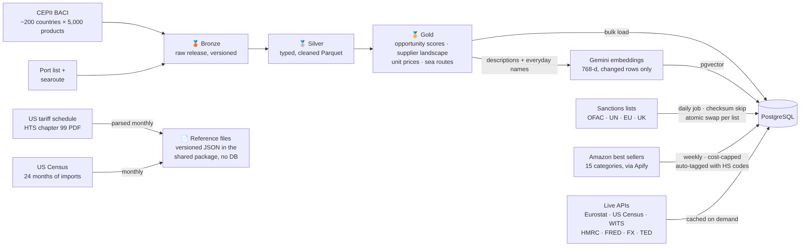
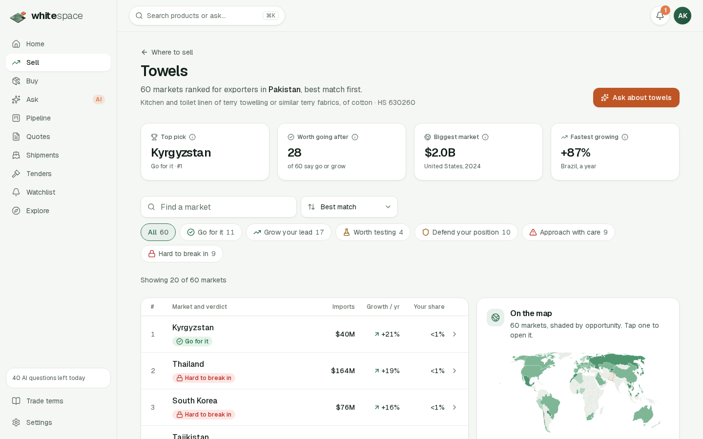
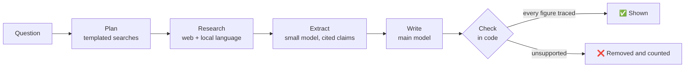
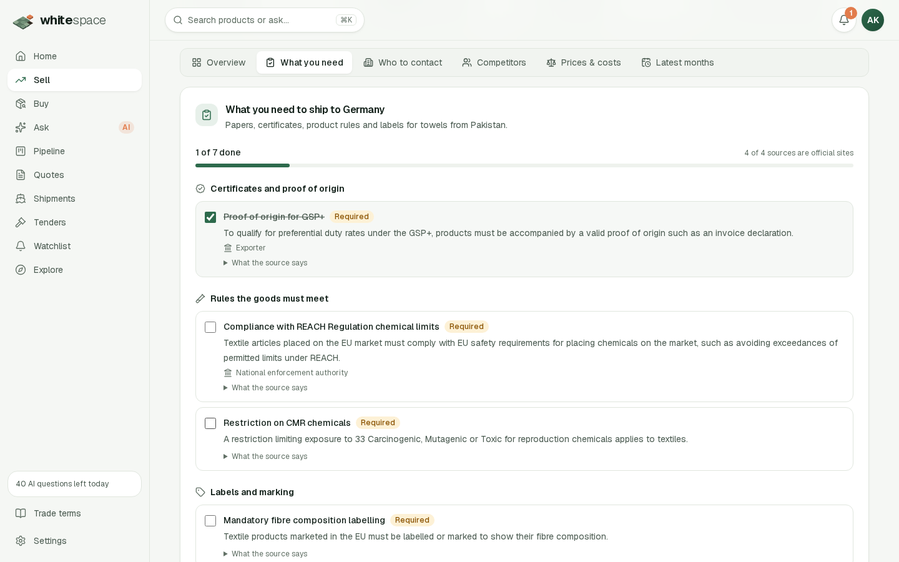
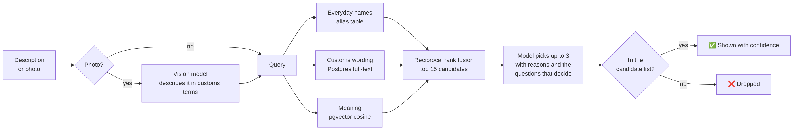
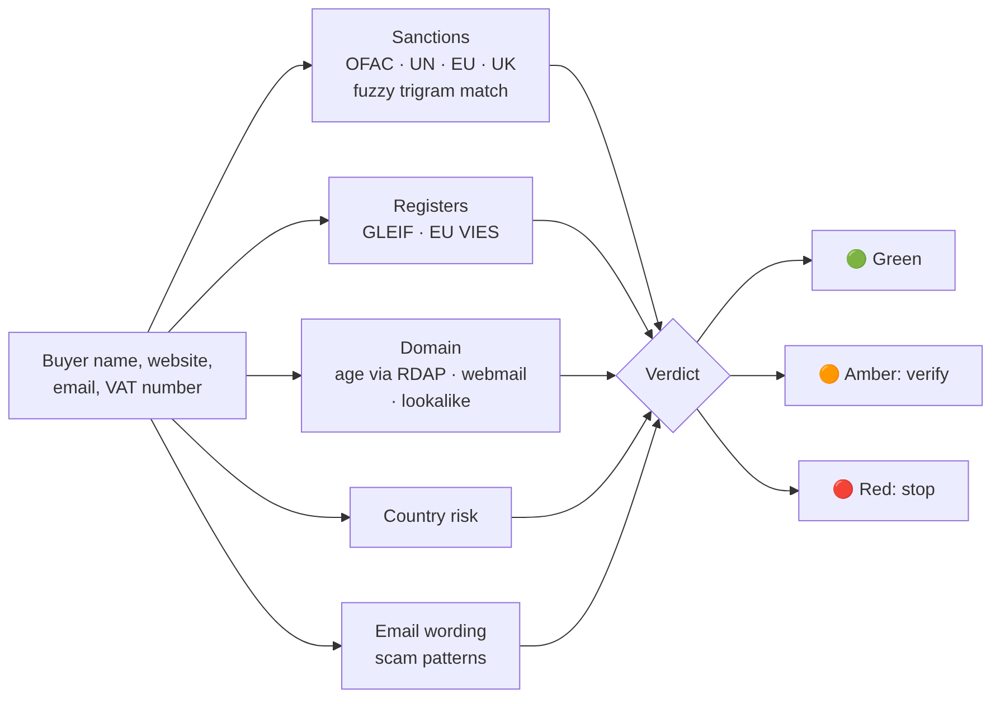
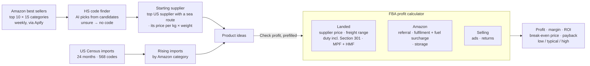
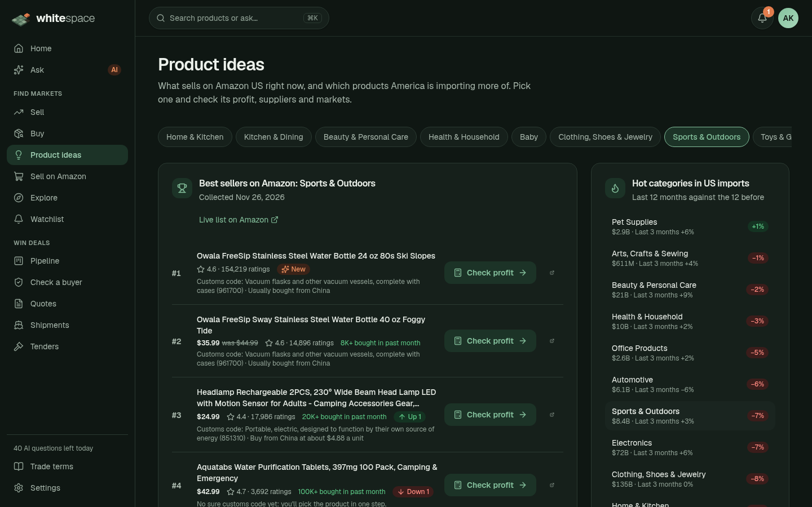
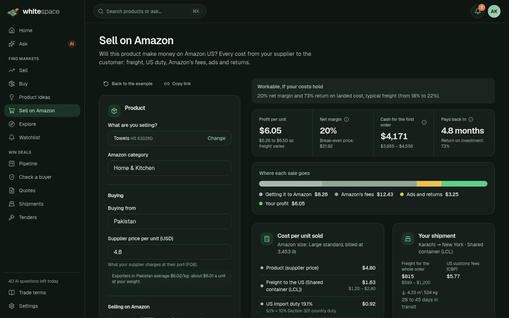
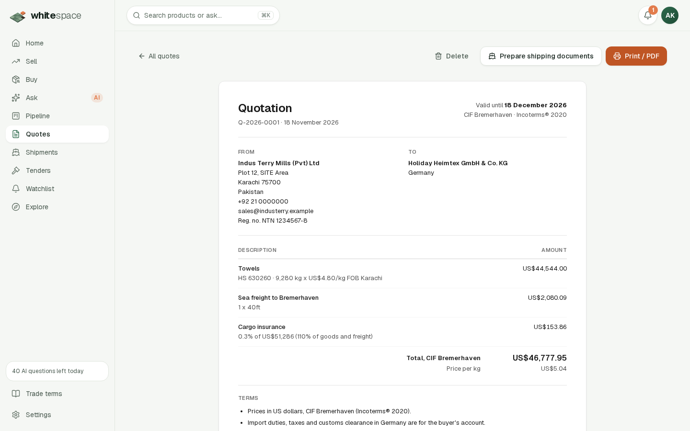

<div align="center">

# Whitespace

### Trade intelligence for exporters and Amazon sellers, built on a real data platform and grounded AI.

Whitespace processes **a million-plus rows of global customs data** into ranked export opportunities, then uses **source-checked AI agents** to turn each opportunity into a deal: the right HS code, the rules to meet, the buyers to call, whether they are safe to deal with, the landed cost, the quote and the shipping documents.

A second mode serves **small Amazon sellers**: product ideas from Amazon's weekly best-seller lists and rising US imports, and a profit calculator built on Amazon's 2026 fees, US tariffs and modelled freight.


<br/>


<br/>

| **1M+** | **5,384** | **24** | **4,796** | **87K+** | **97.5%** | **9** | **490+** |
|:---:|:---:|:---:|:---:|:---:|:---:|:---:|:---:|
| supplier–market rows | HS6 products | exporting countries | sea routes | sanctioned names screened | HS-code accuracy | languages | tests |

</div>

---

## How it works

```
┌────────────┐    ┌────────────┐    ┌────────────┐    ┌────────────┐    ┌────────────┐
│ DATA       │    │ SCORE      │    │ AI AGENTS  │    │ TRUST      │    │ DEAL       │
│ customs,   │ ─► │ rank every │ ─► │ HS codes,  │ ─► │ sanctions, │ ─► │ landed     │
│ tariffs,   │    │ market for │    │ rules,     │    │ buyer, PO  │    │ cost,      │
│ freight,   │    │ a product  │    │ buyers,    │    │ and LC     │    │ quote,     │
│ sanctions  │    │            │    │ emails     │    │ checks     │    │ documents  │
└────────────┘    └────────────┘    └────────────┘    └────────────┘    └────────────┘
Data platform     Scoring model     Grounded AI       Rules in code     Product
```

<br/>

## 🧱 Data platform

A batch pipeline on a **medallion architecture** turns raw customs data into analysis-ready gold tables. The API reads those tables in milliseconds, with no heavy queries at request time.

<picture>
  <source media="(prefers-color-scheme: dark)" srcset="docs/diagrams/data-platform-dark.png">
  
</picture>

| Layer | What happens | Tech |
|---|---|---|
| **Bronze** | Versioned BACI releases kept exactly as published (≈350 MB) | Python, httpx |
| **Silver** | Typed, deduplicated, country codes harmonised, columnar (≈340 MB) | Polars, Parquet |
| **Gold** | Scores, supplier shares, unit prices and routes, compacted to ≈47 MB | Polars, DuckDB |
| **Enrich** | All 5,384 products embedded for meaning search; 87K+ sanctioned names normalised (legal forms stripped) and trigram-indexed for fuzzy matching | Gemini embeddings, pgvector, pg_trgm |
| **Reference** | US additional duties parsed from the official HTS chapter 99 PDF, and 24 months of US consumer imports (568 codes), shipped as small versioned JSON files instead of tables, so every update is a reviewable git diff | pypdf, Polars |
| **Serve** | Bulk-loaded tables, plus live sources cached with lifetimes that match how often each source updates | PostgreSQL (Neon in production), pg_trgm |

**Batch and live, combined.** Annual bilateral trade comes from the batch pipeline. Monthly imports (Eurostat Comext and US Census), tariffs (WITS-TRAINS and HMRC), the Brent oil price (FRED), exchange rates and EU tenders (TED) are fetched live, normalised to one shape and cached. The four official sanctions lists are refreshed by a daily job that skips unchanged files and swaps each list in atomically, so a check never sees a half-loaded list. Product embeddings are incremental: only new or changed text is sent, so re-runs are free and resumable under the embedding API's daily quota. Amazon's best-seller lists are captured weekly through Apify, with a cost cap on each run that keeps a month inside the free plan. The gold-table schemas live in a **shared package** that both the pipeline and the API import, so the two can never disagree about the data shape.

### The opportunity model



For exporter **E**, product **p** and market **M**, over four years of trade:

| Signal | Definition |
|---|---|
| **Growth** | CAGR of M's imports of p |
| **Displacement** | Share lost by M's largest supplier other than E |
| **Headroom** | 1 − E's current share of M |
| **Size** | M's total imports of p |

A market qualifies only if it imports **≥ $10M** of p a year and E has a **revealed comparative advantage ≥ 1**. The score is the mean percentile rank of the four signals. Including size stops one large shipment into a tiny market from outranking a large, steady one. Each score maps to a plain-language verdict, such as *Go for it*, *Grow your lead* or *Hard to break in*.

**Freight is modelled, not guessed.** Real sea-route distances between 4,796 port pairs (including sourcing lanes from East Asia to the US, UK, Germany and Canada), container rates indexed to Brent crude, an adjustment for backhaul on each lane, full-container and shared-container (LCL) pricing, and low / typical / high ranges.

<br/>

## 🤖 Grounded AI

Seven AI agents, with the brief and the guide built as **LangGraph** graphs. They share one rule: **a model may write, but code decides what is true.** Every number and every claim is checked against data or a cited source before a user sees it.

<picture>
  <source media="(prefers-color-scheme: dark)" srcset="docs/diagrams/grounded-ai-dark.png">
  
</picture>

| Agent | What it does | How it stays honest |
|---|---|---|
| **Market brief** | Research → extract → write → check: a structured go-to-market brief | Every figure must trace to a measured fact or a cited claim; the rest is removed |
| **AI guide** (chat) | A tool-using agent with 9 data tools: best markets, market facts, monthly trends, duties, prices, sourcing | Numbers in the answer must appear in tool results; one repair pass, then marked *ungrounded* |
| **Market requirements** | Certificates, product rules and labelling for one lane | Requirement kept only if its quote appears word for word on the source page; official domains preferred |
| **Company leads** | Importers and distributors, found with searches in the local language | Lead kept only if the company name appears on the cited page |
| **Outreach and replies** | Drafts first-contact emails in the buyer's language; reads a pasted reply into asks, a deadline and the next pipeline stage | Any figure not in your own data, and any leftover placeholder, is flagged before sending; every ask must quote the reply word for word |
| **HS code finder** | Finds the six-digit code from a description or a photo, using hybrid RAG (below) | The model can pick only from retrieved candidates, checked in code; scored against an eval set |
| **PO and LC reader** | Reads a buyer's purchase order or letter of credit | SWIFT MT700 is parsed in code; any other value must quote the document; scanned pages are marked unverified |

<table>
<tr>
<td width="50%"></td>
<td width="50%"></td>
</tr>
<tr>
<td align="center"><sub>Requirements: each rule quoted from an official source</sub></td>
<td align="center"><sub>Leads: each company linked to where it was found</sub></td>
</tr>
</table>

### 🔎 Hybrid RAG: finding the HS code

Exporters often don't know their product's customs code, and every other feature starts from it. The finder combines three retrievers, fuses them and lets a model choose only from what was retrieved.

<picture>
  <source media="(prefers-color-scheme: dark)" srcset="docs/diagrams/hs-finder-dark.png">
  
</picture>

- **Three kinds of match.** Everyday names catch "hoodie", full-text search catches customs wording, and embeddings catch meaning when no words overlap.
- **Weighted rank fusion, tuned on evidence.** Reciprocal rank fusion merges the lists without calibrating scores across retrievers. Each retriever's weight was chosen on the eval set, which lifted first-place accuracy from 70% to 87.5% before the model step.
- **Keeps working when a service is down.** Without the embedding API, names and words still run. Without the model, the closest candidates are shown and labelled as such.
- **Also tags Amazon best sellers.** Each new best seller gets a likely code from the same finder; a code the model isn't fairly sure of is left out, because no code beats a wrong one. 92% of the current list is tagged.
- **Measured, not assumed.** `make eval-hs` scores every stage against a 40-case labelled eval set, so each change to the finder is checked before it ships. Latest run, on the full catalogue of 5,384 products:

| Stage | Right code first | Right code in top 3 |
|---|:---:|:---:|
| Customs words only (full-text search) | 37.5% | 55% |
| Words + everyday names | 50% | 75% |
| Meaning only (embeddings) | 87.5% | 95% |
| All three, unweighted fusion | 70% | 90% |
| All three, weighted fusion | 87.5% | 95% |
| **Model's final pick from the 15-candidate shortlist** | **97.5%** | **100%** |

The right code was in the 15-candidate shortlist in every case, so the model always had the answer to choose from.

**Production LLM engineering:**
- **Two model tiers.** A small model extracts and a main model writes, so each step uses the cheapest model that can do it.
- **Key rotation and fallback.** Calls rotate round-robin across keys, a rate-limited key rests automatically, and Gemini falls back to Groq. Ollama runs everything offline for development.
- **Arithmetic in code.** "18 lakh", "2.5 crore" and "5 tons" are parsed deterministically, so the model never does the maths.
- **Cost control.** Token use is recorded per brief, results are cached and shared across users, and each user has daily caps.
- **No model where rules will do.** Sanctions, red flags, date rules and SWIFT parsing are plain code: free, instant and the same answer every time.

<br/>

## 🛡️ Trust and compliance

Before money moves, two checks answer *is this buyer real?* and *is this document safe to accept?* Both are built mainly from **fixed rules and free public data**, so the same input always gives the same answer, and every finding comes with its source.

<picture>
  <source media="(prefers-color-scheme: dark)" srcset="docs/diagrams/buyer-check-dark.png">
  
</picture>

| Check | What it does | How it stays honest |
|---|---|---|
| **Buyer check** | Screens a company against four sanctions lists, legal-entity and VAT registers, website age, email domain and the wording of their emails | Strong and possible matches are graded separately; generic words such as "trading" never match alone; it says what it can't tell you, such as whether they will pay |
| **PO and LC checker** | Reads a purchase order or letter of credit and compares every term with your quote | Flags soft clauses that let the buyer block payment, dates that leave too little time to ship (UCP 600), and a sanctioned issuing bank; nothing uploaded is stored |


<br/>

## 🛒 Amazon FBA mode

For makers and small importers who want to sell on Amazon US with Fulfilment by Amazon (FBA). It answers two questions with named sources: *what could I sell?* and *would it make money?* Both pages are also public, with no sign-up.

<picture>
  <source media="(prefers-color-scheme: dark)" srcset="docs/diagrams/amazon-fba-dark.png">
  
</picture>

<table>
<tr>
<td width="50%"></td>
<td width="50%"></td>
</tr>
<tr>
<td align="center"><sub>Product ideas: best sellers with a customs code and a usual source country</sub></td>
<td align="center"><sub>Profit calculator: towels from Pakistan, every cost from supplier to customer</sub></td>
</tr>
</table>

| Cost | Where it comes from |
|---|---|
| **Amazon fees** | Amazon's 2026 referral, fulfilment and storage fees, including the 3.5% fuel and logistics surcharge; dated in code and reviewed at each Amazon fee change |
| **US duties** | Normal duty plus Section 301 country duties and China's list duties, parsed from the official tariff schedule; exemptions applied |
| **Import fees** | US Customs processing fee (formal and informal entries) and harbour maintenance fee |
| **Freight** | The sea-freight model above, priced on the order's real volume as a low / typical / high range |

Inputs only the seller knows (ad spend, returns, monthly sales) are labelled as assumptions, and anything not modelled, such as Section 232 and anti-dumping duties, is named on the page. A tariff that covers only part of a product code is still applied, because understating a seller's cost is the mistake that loses them money.

<br/>

## 📦 From opportunity to shipment

<table>
<tr>
<td width="50%"></td>
<td width="50%"></td>
</tr>
<tr>
<td align="center"><sub>Deal sheet: the market case and landed cost on one shareable page</sub></td>
<td align="center"><sub>Quote: Incoterms-aware, with freight and insurance worked out</sub></td>
</tr>
</table>

<details>
<summary><b>See every feature</b></summary>

<br/>

**Discover**
- Markets ranked for any product, plus Compare, Browse, Niche and Grow-range views
- A Buy / Sourcing side for importers looking for suppliers
- Watchlists, with alerts when new monthly data moves a market

**Validate**
- HS code finder from a plain description or a product photo
- Import duties by partner country, including preferential rates such as GSP+ and US Section 301 duties
- AI market-requirements checklist that users tick off as they prepare

**Cost**
- Freight estimator for full and shared (LCL) containers, with the break-even volume between them
- Landed-cost receipt with live exchange rates

**Connect**
- AI company leads, with first emails drafted in the buyer's language
- Reply reader: paste a buyer's email to get their asks, deadline and a drafted answer, with the pipeline card updated
- Sales pipeline: stages, conversation history, follow-up reminders, weekly email digest
- Buyer check: sanctions, company registers, domain age and scam wording, with a red / amber / green verdict
- EU public tenders (TED) matched to your products through an HS-to-CPV mapping, with daily alerts

**Close and ship**
- Deal sheet with the numbers kept in the URL, so a shared link shows the same sheet, plus print to PDF
- Quotes for FOB, CFR, CIF and DAP, with gapless numbering
- PO and letter-of-credit checker that compares the buyer's terms with your quote
- Commercial invoice, packing list, statement on origin and REX-threshold warnings

**Sell on Amazon**
- Product ideas: weekly Amazon best sellers in 15 categories and rising US imports, each with a likely HS code and a starting supplier
- FBA profit calculator with Amazon's 2026 fees, US duties, import fees and freight ranges, free to use without an account

**Platform**
- Email and password (Argon2) or Google sign-in, password reset, HTTP-only cookie sessions
- 9 languages, with right-to-left layouts for Urdu and Arabic
- Admin console: sign-ups, active users, visitor countries, pages and engaged time, account disabling, and test or demo accounts kept out of the numbers
- Cookie-free, first-party analytics: no third-party trackers, and no IP addresses stored

</details>

<br/>

## 🏗️ Architecture

<picture>
  <source media="(prefers-color-scheme: dark)" srcset="docs/diagrams/architecture-dark.png">
  
</picture>

- **One typed contract, end to end.** The frontend's API client is generated from the backend's OpenAPI spec, so changing an endpoint breaks the frontend build, not production.
- **Correct under concurrency.** Quote and invoice numbers are gapless and allocated under row locks. Pipeline cards use version-checked writes. Scheduled jobs hold database leases. A model is never called while a row is locked.
- **Secure by default.** Argon2 password hashing, secure HTTP-only cookies, rate limits that trust only known proxy hops, HMAC-signed links, hardened response headers, uploaded documents checked in memory and never stored, admins who see counts but never message text, and an API reachable only through the HTTPS proxy.
- **Production on one small server.** Live on a single AWS t4g.micro (ARM64, 1 GB RAM): Caddy for automatic HTTPS, plus the API and web containers, with Neon serverless Postgres. The whole stack uses about 550 MB of RAM.
- **One-command deploys.** `make deploy-ec2` builds ARM64 images, uploads only the ones that changed, runs database migrations, then restarts. Configuration is environment variables only, so the same images run on any host.
- **Privacy-respecting analytics.** Visitors are counted with a hash that changes every day, with no cookies, and only the country is kept from an IP address.

| | |
|---|---|
| **Frontend** | Next.js 16 · React 19 · TypeScript · Tailwind CSS 4 · TanStack Query |
| **Backend** | FastAPI · SQLAlchemy 2 (async) · Alembic · Pydantic v2 |
| **Data** | Polars · DuckDB · Parquet · pypdf · PostgreSQL (pgvector, pg_trgm, full-text search) · Apify |
| **AI** | LangGraph · LangChain · Gemini (chat, vision, embeddings) · Groq · Ollama · Tavily · hybrid RAG |
| **Infra** | Docker Compose · Caddy · AWS EC2 (ARM64) · Neon Postgres |
| **Quality** | pytest · eval sets · Ruff · mypy · ESLint · GitHub Actions |

<br/>

## 🚀 Getting started

```bash
make env    # create .env, then add a free Google AI Studio key (GOOGLE_API_KEY_1)
make up     # start web, API and database in Docker
```

Open **http://localhost:3400** for the app or **http://localhost:8400/docs** for the API reference.

<details>
<summary><b>Local development, data pipeline and checks</b></summary>

<br/>

**Prerequisites:** Docker with Compose, [uv](https://docs.astral.sh/uv/), and Node.js 20.9+ with pnpm.

```bash
make install     # Python and frontend dependencies
make db          # Postgres only
make migrate     # apply migrations
make api         # API with hot reload on :8400
make web         # web app with hot reload on :3400

make check       # lint + typecheck + tests (what CI runs)
make gen-client  # regenerate frontend API types after changing an endpoint
make check-keys  # test every configured API key without printing it
make sanctions   # load the OFAC, UN, EU and UK sanctions lists (also refreshed daily)
make embed       # embed products for HS-code search (only new or changed ones)
make eval-hs     # score the HS-code finder (ARGS=--pick to include the AI step)
make us-tariffs  # rebuild US additional duties from the official tariff schedule (monthly)
make us-imports  # rebuild 24 months of US consumer imports from the Census Bureau (monthly)
make geoip       # download the free DB-IP country database for visitor countries
make deploy-ec2  # build ARM64 images and deploy to the EC2 server
make help        # every command
```

**Optional keys** switch on their features: Groq (LLM fallback), Tavily (leads and requirements), US Census (US monthly data), Apify (Amazon best sellers), Google OAuth and SMTP. `.env.example` lists every key.

**Repository layout**

```
frontend/   Next.js app: product UI, public pages, i18n
backend/    FastAPI: API, AI agents, integrations, jobs, migrations, evals
pipeline/   Data pipeline: bronze → silver → gold → load
shared/     Gold-table schemas and reference data (US tariffs, US imports, Amazon categories)
deploy/     Production deploy: EC2 with Caddy, API and web (plus a single-container fallback)
docs/       Architecture decisions, diagrams (Mermaid sources + renders) and screenshots
```

</details>

---

<div align="center">
<sub>Built entirely on public data. Scores describe where a country competes well. They are not a guarantee for any single firm. Fee and tariff figures are dated in the code and reviewed when they change.</sub>
</div>
