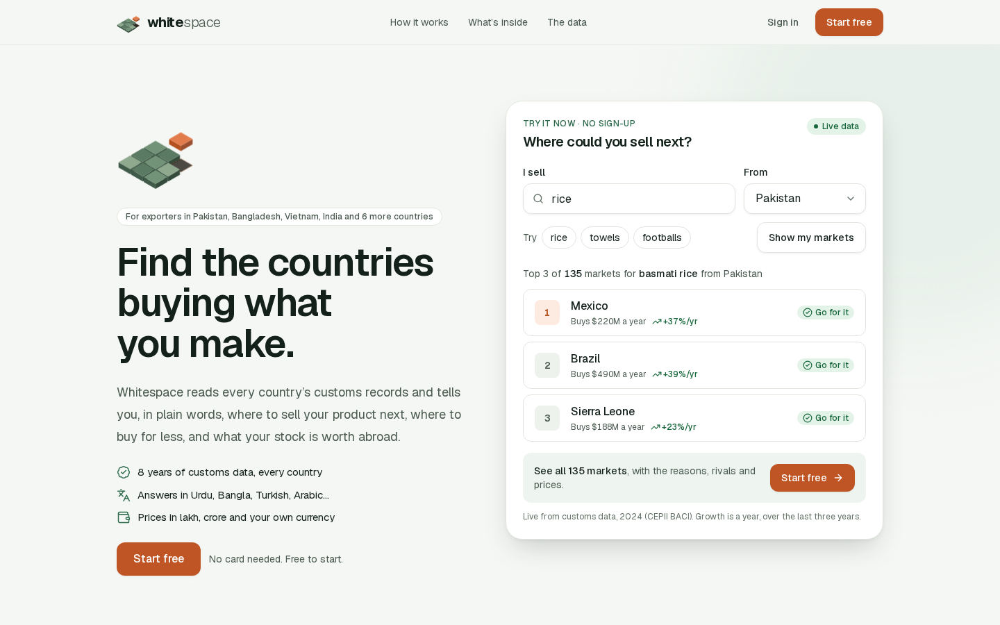
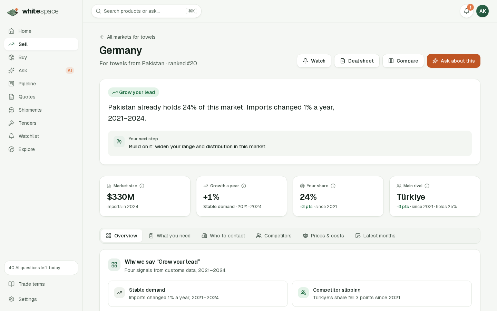
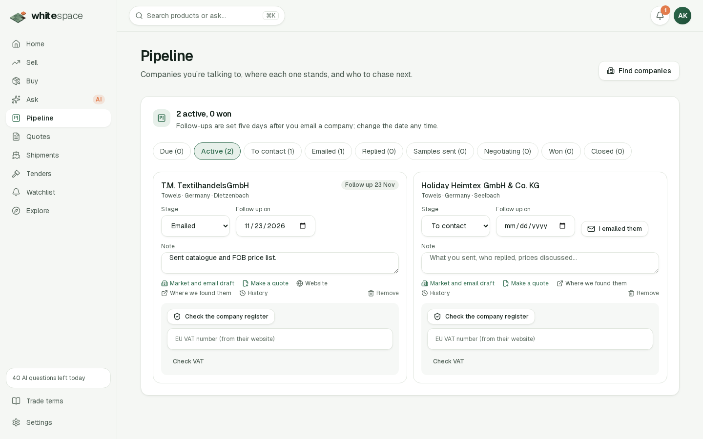
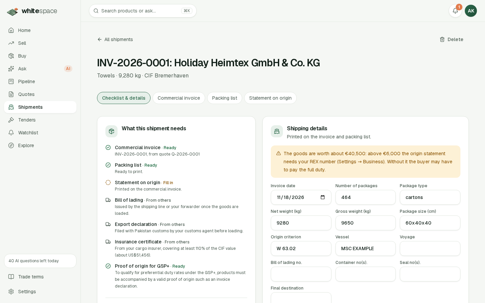
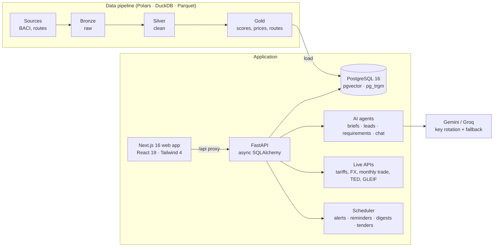

<div align="center">

# Whitespace

**Export intelligence for small exporters: find the market, check the rules, price the shipment, reach the buyer, send the quote.**

Whitespace turns free, public global trade data into concrete next moves for an exporter: *where* to sell a product next, *why now*, *what it will cost to land there*, and *who to talk to*. A data pipeline, a scoring model and source-grounded AI agents back every one of those answers.


<br/>


</div>

---

## Why Whitespace

Exporters in emerging markets usually pick their next market by gut feel, by trade-fair luck, or with consultants they can't afford. The data to decide well is public, but it's spread across a dozen agencies, formats and update cycles. Whitespace brings it together into one workflow:

```
  Discover  ──►  Validate  ──►  Cost  ──►  Connect  ──►  Close  ──►  Ship
  where to       rules and      freight,    buyers,      quotes,     invoices,
  sell next      duties         landed      pipeline,    deal        origin
                                cost        tenders      sheets      statements
```

## Product tour

Below, a towel maker in Pakistan follows one opportunity from discovery to shipment.

<table>
<tr>
<td width="50%" valign="top">
<b>1 · Try it before signing up</b><br/>
<sub>The landing page answers "where could I sell?" live from customs data.</sub><br/><br/>

</td>
<td width="50%" valign="top">
<b>2 · Every market, ranked</b><br/>
<sub>60 markets for towels, each with a plain-language verdict and an opportunity map.</sub><br/><br/>

</td>
</tr>
<tr>
<td width="50%" valign="top">
<b>3 · The case for one market</b><br/>
<sub>Size, growth, your share and the main rival, plus the next step to take.</sub><br/><br/>

</td>
<td width="50%" valign="top">
<b>4 · What you need to ship there</b><br/>
<sub>Certificates, chemical rules and labelling, each quoted from an official source page.</sub><br/><br/>

</td>
</tr>
<tr>
<td width="50%" valign="top">
<b>5 · Who to contact</b><br/>
<sub>Importers, wholesalers and brands found on the web, each linked to the page it was found on.</sub><br/><br/>

</td>
<td width="50%" valign="top">
<b>6 · The deal sheet</b><br/>
<sub>Price, freight, duty and landed cost in one shareable, printable page.</sub><br/><br/>

</td>
</tr>
<tr>
<td width="50%" valign="top">
<b>7 · Work the pipeline</b><br/>
<sub>Track each company's stage, set follow-up reminders and check company registers.</sub><br/><br/>

</td>
<td width="50%" valign="top">
<b>8 · Send a quote</b><br/>
<sub>Incoterms-aware quotations with freight and insurance worked out for you.</sub><br/><br/>

</td>
</tr>
<tr>
<td colspan="2" valign="top">
<b>9 · Ship it</b><br/>
<sub>Invoice, packing list and statement on origin, with a checklist for the lane and REX-threshold warnings.</sub><br/><br/>

</td>
</tr>
</table>

## Features

### Discover: where to sell next
- **Opportunity ranking:** every market scored for a product and an exporting country on demand growth, share left open by a fading incumbent, room to grow, and market size. Covers **24 exporting countries** and every HS6 product.
- **Market detail:** import trends, supplier shares, unit prices and the competitive landscape for each product–market pair.
- **Fresh monthly signals** from Eurostat Comext (EU-27) and the US Census Bureau, about two months behind real time.
- **Compare, Browse, Niche and Grow-range views** to look at products and markets from different angles, plus a **Buy / Sourcing** side for importers looking for suppliers.
- **Watchlists and alerts:** in-app (and email) notifications when new data moves a market you follow.

### Validate: can I actually sell there?
- **Import duties** by partner country (WITS-TRAINS for every market, HMRC for the UK live), including preferential rates.
- **Market requirements:** an AI agent researches standards, certifications and labelling rules. Every requirement must be quoted word for word from a cited source page, official domains are preferred, and requirements are de-duplicated. Exporters tick items off as they prepare.

### Cost: what does it take to land the goods?
- **Freight estimator:** real sea-route distances (`searoute`) between curated ports, container rates tied to the Brent oil price (FRED), lane-direction adjustments for backhaul trade, and low / typical / high ranges.
- **Full and shared container (LCL)** options, with the break-even volume between them.
- **Landed-cost receipt:** product price, freight, insurance, port fees and duty in one line-by-line breakdown, with live exchange rates.

### Connect: who do I talk to?
- **Company leads:** an AI agent finds importers and distributors through web search, including searches in the local language. A lead is kept only if the company name actually appears on the cited page.
- **Sales pipeline:** a CRM board for contacts, with stage history, optimistic concurrency control, follow-up reminders and a weekly email digest.
- **Company verification** against the GLEIF legal-entity register and the EU VIES VAT register.
- **Public tenders:** EU procurement notices (TED) matched to your products through an HS-to-CPV mapping, with daily alerts.
- **AI-drafted intro emails** and an in-app **AI guide** (streamed chat) that answers in the context of your markets.

### Close and ship
- **Deal Sheet:** one shareable, printable page per opportunity that combines the market case, freight, landed cost, requirements, contacts and an AI-written market brief. The numbers live in the URL, so a link reproduces the same sheet.
- **Quotes:** Incoterms-aware (FOB, CFR, CIF, DAP), gapless per-company numbering, letterhead, and print or PDF output.
- **Shipping documents:** commercial invoices created from quotes, with a statement on origin (EU GSP wording where it applies), REX-threshold warnings and a pre-shipment checklist for the lane.

### Platform
- **Accounts:** email and password (Argon2 hashing), Google sign-in, password reset by email, HTTP-only cookie sessions with refresh tokens.
- **9 languages:** English, Urdu, Bengali, Vietnamese, Turkish, Spanish, Portuguese, Indonesian and Arabic, with right-to-left layouts for Urdu and Arabic.
- **Privacy-friendly first-party analytics** and an admin console, with no third-party trackers.
- **Onboarding, a glossary and a getting-started guide** written in plain language for first-time exporters.

## How the opportunity score works

For exporter **E**, product **p** and market **M**, over the last four years of bilateral trade data:

| Signal | Meaning |
|---|---|
| **Growth** | Compound annual growth of M's imports of p |
| **Displacement** | Market share lost by M's largest supplier (other than E) |
| **Headroom** | 1 − E's current share of M's imports |
| **Size** | M's total imports of p |

A market qualifies only if it imports at least **$10M** of p a year and E has a **revealed comparative advantage ≥ 1** in p. The score is the mean of the four signals' percentile ranks across E's qualifying markets. Market size is included on purpose, so that one large shipment into a tiny market can't outrank a large market with steady demand.

## Data sources

All sources are free and public.

| Source | Used for |
|---|---|
| **CEPII BACI** (harmonised UN Comtrade) | Bilateral trade flows, the basis of every score |
| **Eurostat Comext** · **US Census Bureau** | Monthly import signals for the EU-27 and the US |
| **WITS-TRAINS** (World Bank / UNCTAD) · **UK Trade Tariff** (HMRC) | Import duty rates, MFN and preferential |
| **FRED** (Brent crude) · **searoute** | Freight-rate index and sea distances |
| **ExchangeRate-API** | Daily currency conversion |
| **TED** (EU Tenders Electronic Daily) | Public procurement notices |
| **GLEIF** · **EU VIES** | Company and VAT-number verification |
| **Tavily** web search + Gemini / Groq LLMs | Leads, market requirements, briefs and the AI guide |

## Architecture



**Medallion pipeline.** Raw trade data goes through bronze, silver and gold layers. The gold tables follow schemas in a shared package that both the pipeline and the API import, so the two can never disagree about the data shape.

**One typed contract, end to end.** The frontend's API client is generated from the backend's OpenAPI spec (`make gen-client`). Changing an endpoint breaks the frontend build, not production.

**First-party cookies by design.** The browser only ever talks to the web app, which proxies `/api/*` to the API. Auth cookies stay first-party wherever the two are hosted.

## Engineering highlights

- **Grounded AI, not guessed AI.** Agents cite sources, and code checks the citations: a lead is dropped if its company name doesn't appear on the cited page, and a requirement is dropped if its quote can't be found on the source page. LLM output is never shown as fact without a check.
- **Resilient LLM layer.** Several keys per provider are rotated round-robin, a rate-limited key is rested automatically, and calls fall back from Gemini to Groq. Ollama runs the models fully offline for local development. Per-user daily caps keep usage inside free quotas.
- **Shared caching.** Expensive results (leads, requirements, briefs, tenders, tariffs) are cached with source-appropriate lifetimes, so a second user asking the same question costs nothing.
- **Correct under concurrency.** Quote and invoice numbers are gapless and allocated under row locks. Pipeline cards use version-checked writes. Scheduled jobs take a database lease, so only one instance runs a job even when several are up.
- **Security by default.** Argon2 password hashing, HTTP-only secure cookies, rate limiting on public and auth endpoints that trusts only known proxy hops, HMAC-signed unsubscribe links, hardened response headers (HSTS, frame-ancestors, nosniff), an API bound to localhost inside the container, and no secrets in logs.
- **Built to run at zero cost.** Every part is a plain container configured only by environment variables. The production image combines web and API into one ARM64 container of about 140 MB that idles at about 150 MB of RAM, backed by serverless Postgres.
- **Tested.** 300+ automated tests, linting and strict type checks for Python and TypeScript, and CI that runs only the parts a change touches.

## Tech stack

| Layer | Technology |
|---|---|
| Frontend | Next.js 16 (App Router), React 19, TypeScript, Tailwind CSS 4, TanStack Query, generated OpenAPI client |
| Backend | FastAPI, SQLAlchemy 2 (async), Alembic, Pydantic v2, LangChain |
| Data | Polars, DuckDB, Parquet, PostgreSQL 16 with pgvector and pg_trgm |
| AI | Google Gemini, Groq, Ollama (local), Tavily search |
| Tooling | uv, pnpm, Ruff, mypy, pytest, ESLint, Docker Compose, GitHub Actions |

## Getting started

### Prerequisites
- Docker with Compose
- [uv](https://docs.astral.sh/uv/) (installs Python 3.12 for you)
- Node.js 20.9+ with pnpm (`corepack enable`)

### Run everything in Docker

```bash
make env       # create .env from .env.example, then add your keys
make up        # build and start the stack
```

| Service  | URL |
|----------|-----|
| Web app  | http://localhost:3400 |
| API docs | http://localhost:8400/docs |
| Postgres | `localhost:5440` (user, password and database: `whitespace`) |

### Local development with hot reload

```bash
make install   # Python and frontend dependencies
make db        # Postgres only, in Docker
make migrate   # apply database migrations
make api       # API on :8400
make web       # web app on :3400 (in a second terminal)
```

### Keys

AI features need one free **Google AI Studio** key (`GOOGLE_API_KEY_1`). Everything else is optional and switches on its feature when set: Groq keys (LLM fallback), `TAVILY_API_KEY` (leads and requirements), `CENSUS_API_KEY` (US monthly data), Google OAuth (sign-in) and SMTP (password reset and digests). Run `make check-keys` to test every configured key without printing it. `.env.example` lists every key.

## Development

```bash
make check       # lint + typecheck + tests (what CI runs)
make format      # auto-format Python and frontend code
make gen-client  # regenerate frontend API types after changing an endpoint
make alerts      # run the watched-market alert job once
make help        # every available command
```

## Repository layout

```
whitespace/
├── frontend/    Next.js web app: product UI, public market pages, i18n
├── backend/     FastAPI service: API, AI agents, integrations, scheduled jobs
│   └── migrations/   Alembic schema history
├── pipeline/    Data pipeline: download → clean → score → load
├── shared/      Gold-table schemas shared by the pipeline and the backend
├── deploy/      Production container build
├── docs/adr/    Architecture decision records
├── scripts/     Build and maintenance scripts
└── Makefile     Every common command (run `make`)
```

## Deployment

`make snapdeploy` builds a single ARM64 image containing the web app and the API, as a tarball in `dist/`. In that image, the web server is the only public port and the API listens on localhost behind it. Database migrations run separately against the production database (`make migrate` with the production `DATABASE_URL`). Because every component reads its configuration only from environment variables, moving to another host or splitting web and API apart is a configuration change, not a code change.

---

<div align="center">
<sub>Built with public data. Scores describe where a country competes well. They are not a guarantee for any single firm.</sub>
</div>
